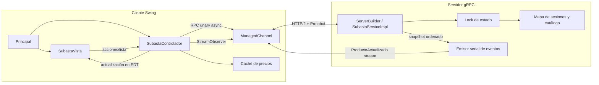
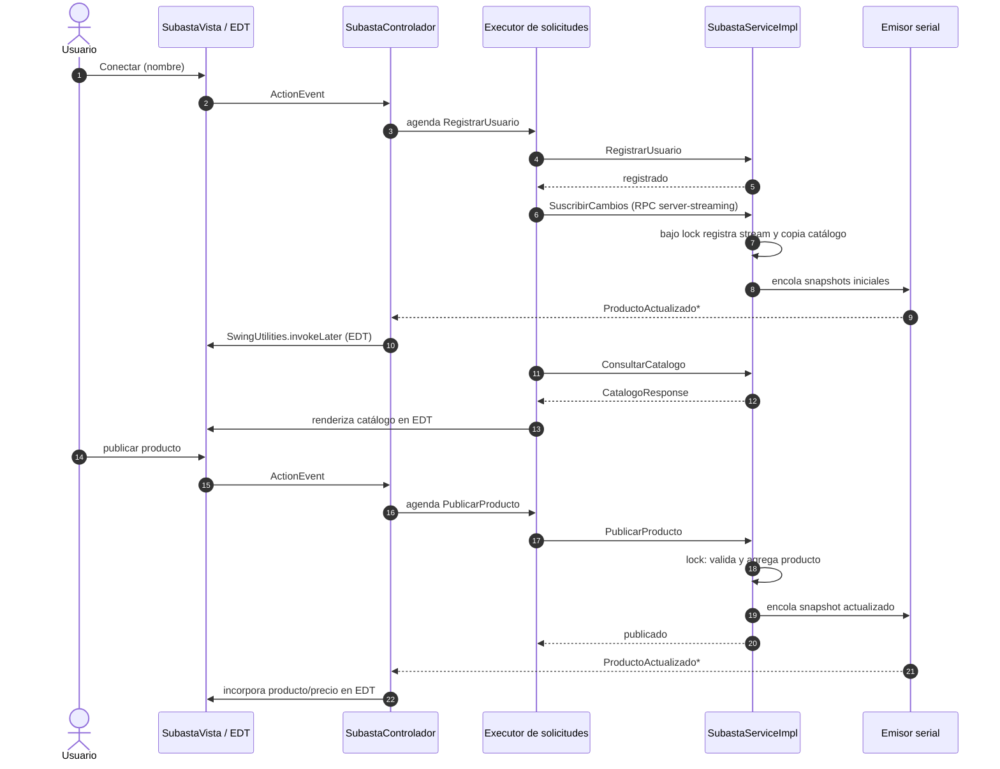
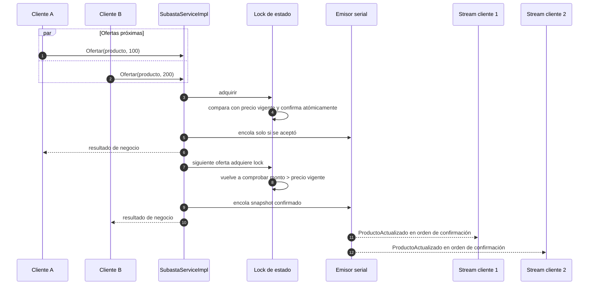
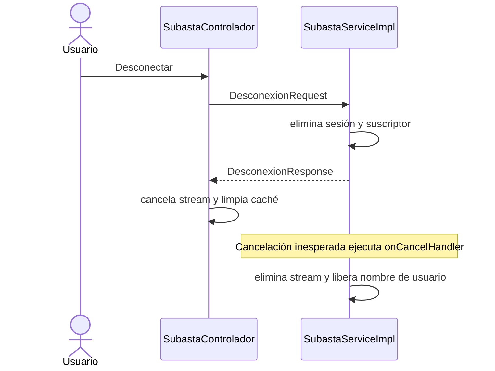

# Diagramas del módulo gRPC

Los diagramas describen el código final bajo `grpc/src/` y el contrato de
`grpc/proto/subasta.proto`.

## Componentes

No se envían DTO RMI por la red. `ProductoSubasta` es estado interno y se mapea a
mensajes generados por protobuf.

## Suscripción, publicación y actualización

El stream permanece abierto sin ocupar el hilo de Swing ni bloquear los botones. El
catálogo se envía al suscriptor en la misma sección crítica en que se registra el stream;
por tanto, cambios concurrentes quedan después de la instantánea inicial en la cola del
emisor.

## Ofertas concurrentes y broadcast

El orden de llegada de las dos solicitudes no se presupone. Una oferta inferior a la
vigente se rechaza; la serialización de actualizaciones y eventos evita notificaciones
fuera de orden para una secuencia aceptada.

## Desconexión

