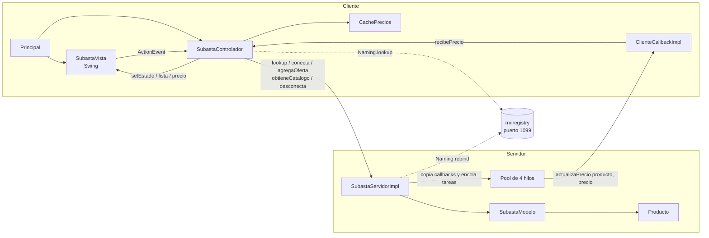
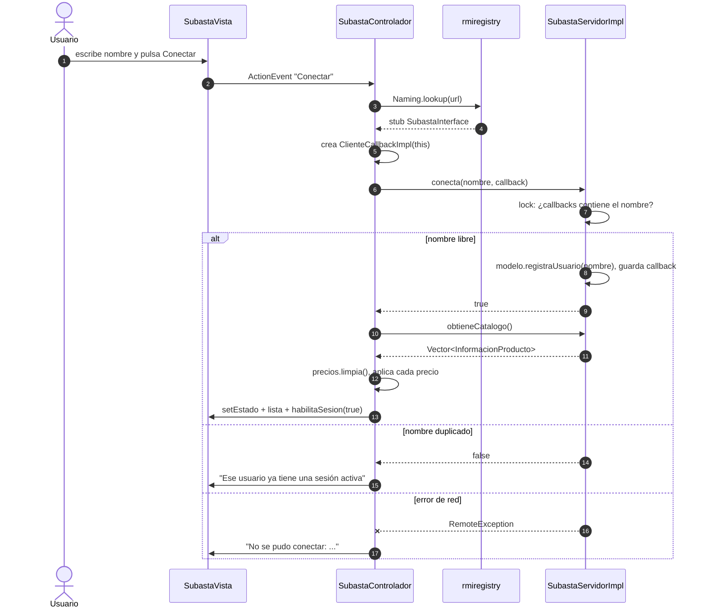
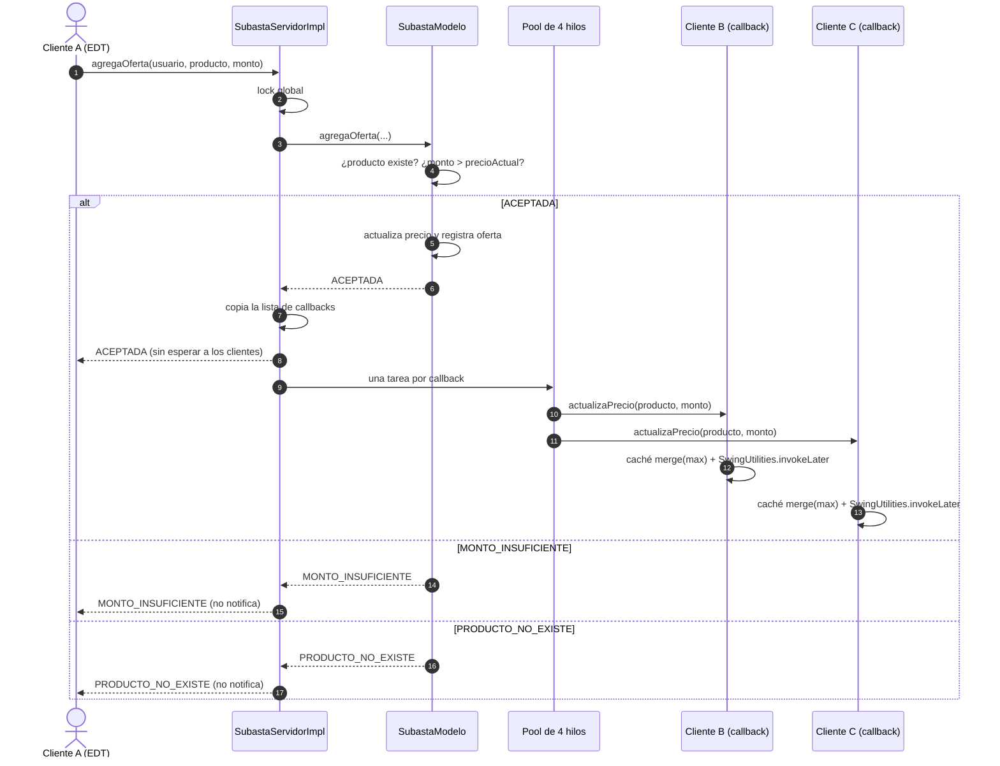
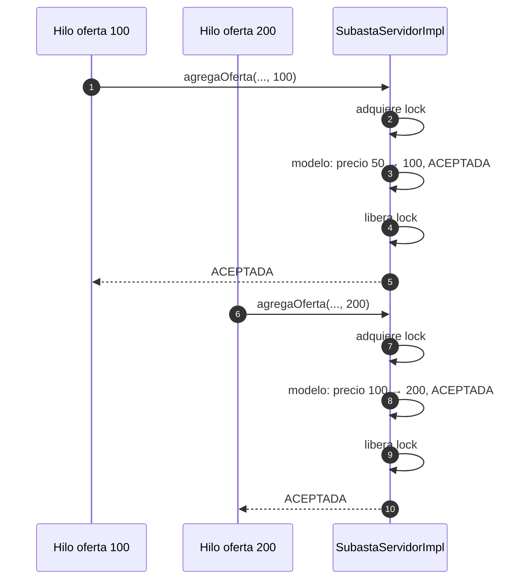
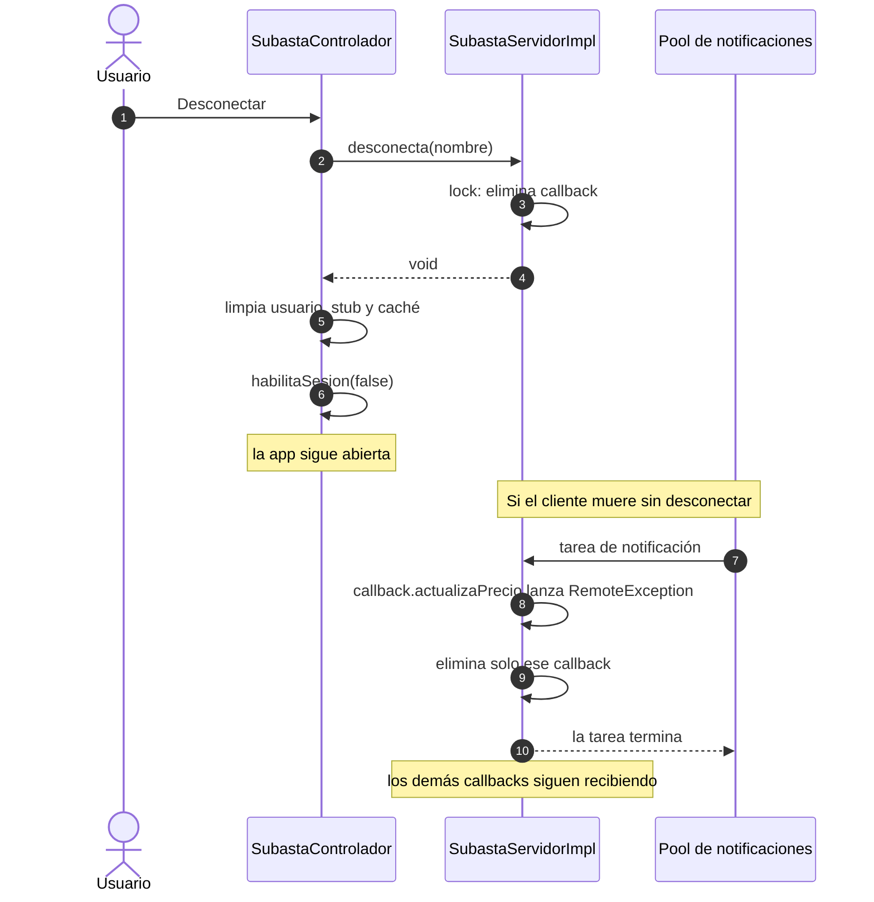
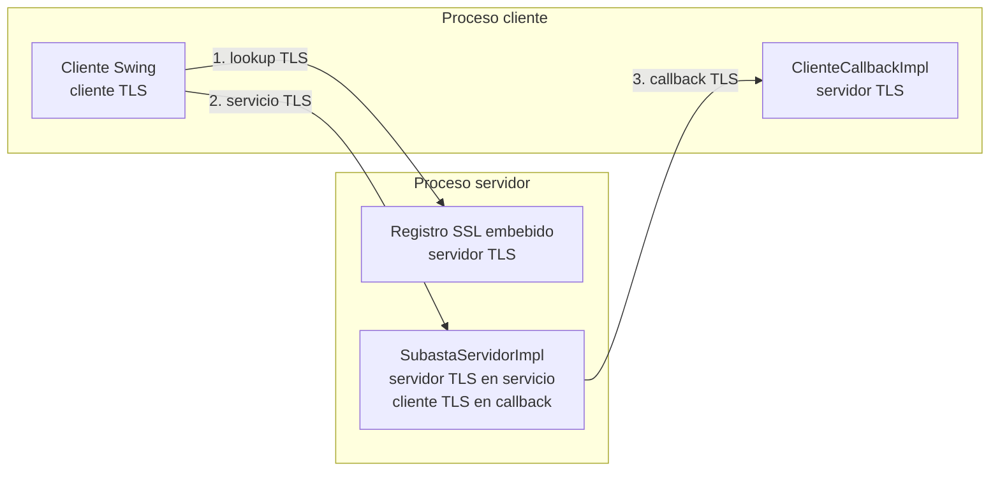
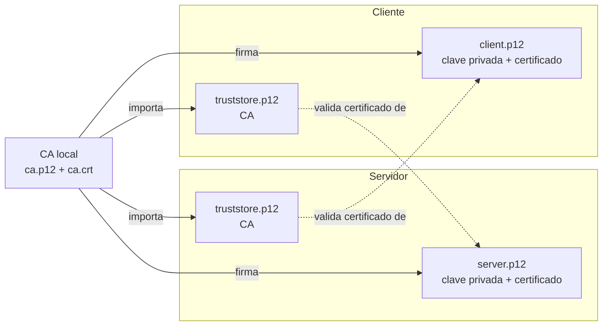
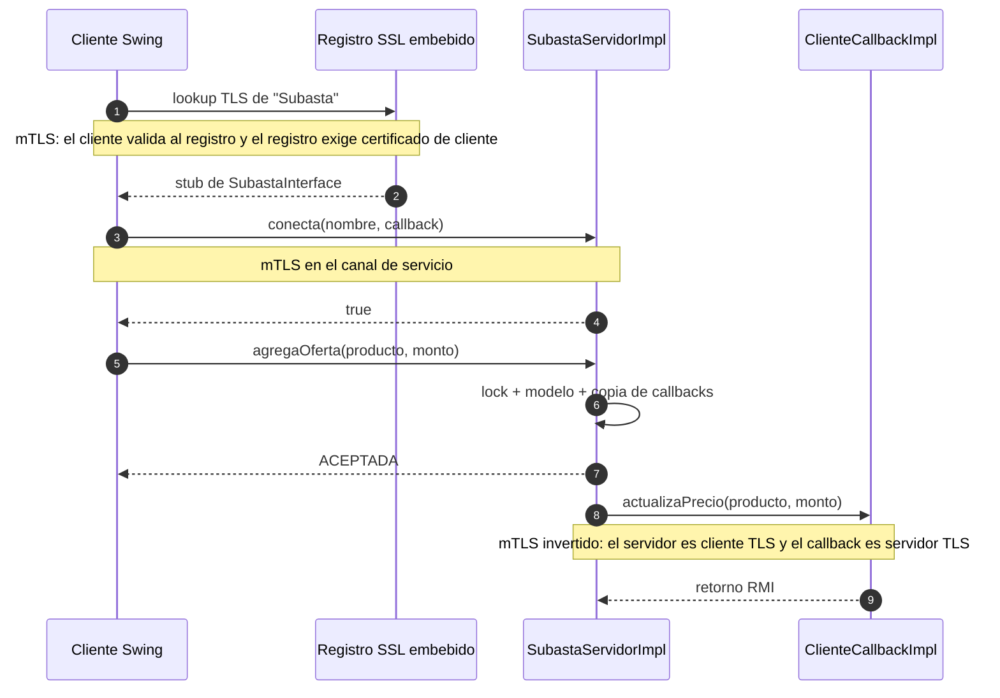
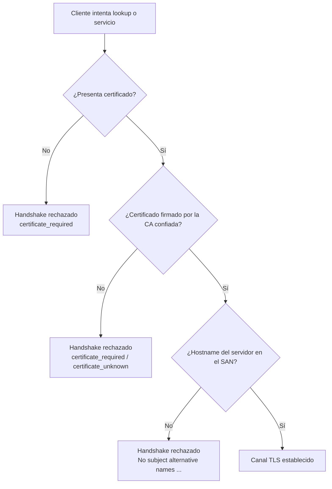

# Diagramas del módulo RMI

Los diagramas describen el código implementado en `rmi/src/` para el perfil
plano y el perfil TLS. No incluyen componentes que no existan en esta entrega.

Última actualización: **2026-11-07**.

## Componentes

`SubastaModelo` no conoce RMI ni `RemoteException`. `Producto` es mutable y nunca cruza la
red; `InformacionProducto` e `InformacionOferta` son los DTO inmutables que sí se serializan.

## Conexión de un cliente

El callback se crea una sola vez y se reutiliza si el usuario se desconecta y vuelve a
conectar en la misma ventana.

## Oferta con notificación diferida

El lock se libera antes de encolar las notificaciones. Un callback lento no bloquea la
oferta ni a los demás clientes; un callback que falla se elimina de `callbacks` sin revertir
el cambio de precio.

## Concurrencia de dos ofertas

Con el lock global, la comprobación y la actualización del precio son atómicas. Si el orden
fuera el inverso, la oferta de 100 se rechazaría y el precio final seguiría siendo 200.

## Desconexión y fallo de callback

## TLS: canales y roles

El registro se crea con `LocateRegistry.createRegistry(puerto, csf, ssf)` dentro
del proceso servidor. En el callback los papeles se invierten: el servidor de
subastas inicia la conexión como cliente TLS y el cliente la acepta como
servidor TLS.

## TLS: material de confianza

Los keystores aportan identidad; los truststores aportan confianza. Los
certificados llevan SAN `dns:localhost,ip:127.0.0.1` y los scripts fijan
`java.rmi.server.hostname=localhost` para que coincida con el hostname que
anuncia el stub.

## TLS: conexión, oferta y callback

La oferta se confirma al cliente antes de notificar a los demás. La notificación
usa el canal TLS del callback y no el canal de servicio; si el callback no
tuviera TLS, la oferta seguiría cifrada pero la notificación viajaría en claro.

## TLS: casos negativos

Las tres ramas negativas se ejecutan en `rmi/run/pruebas-tls-negativas.sh`. La
prueba también comprueba que el servidor sigue vivo después de cada rechazo.
