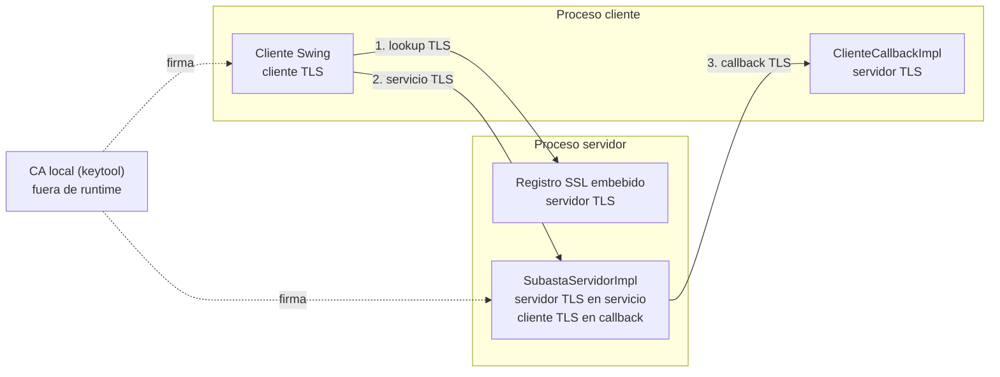

# Seguridad TLS — perfil opcional

> **Estado:** documento revisado e integrado. El perfil TLS se
> ejecuta con `rmi/run/pruebas-tls.sh` y las negativas con
> `rmi/run/pruebas-tls-negativas.sh`. Este documento explica **qué protege**,
> **qué no protege** y **cómo se comprueba**.

## 1. Qué se protegió

El perfil TLS cubre los tres canales de RMI:

| Canal | Para qué sirve | Quién es servidor TLS | Quién es cliente TLS |
|---|---|---|---|
| Registro | Traducir `"Subasta"` → stub | Registro embebido | Cliente Swing |
| Servicio | `conecta`, `agregaProductoALaVenta`, `agregaOferta`, `obtieneCatalogo`, `desconecta` | `SubastaServidorImpl` | Cliente Swing |
| Callback | `actualizaPrecio` del servidor al cliente | `ClienteCallbackImpl` | `SubastaServidorImpl` |

En el callback los papeles se invierten: el cliente es el servidor TLS y el
servidor de subastas es el cliente TLS. Por eso **ambos procesos necesitan
keystore y truststore**.

El registro se crea dentro del proceso servidor con
`LocateRegistry.createRegistry(puerto, csf, ssf)`. El `rmiregistry` externo no
ofrece una opción estándar de factories SSL; si se dejara externo, el `lookup`
y la descarga del stub viajarían en claro.

### Diagrama rápido de canales y roles



El registro y el servicio usan mTLS con el cliente como cliente TLS. En el
callback los papeles se invierten: el servidor de subastas inicia la conexión
como cliente TLS y `ClienteCallbackImpl` la acepta como servidor TLS.

## 2. Qué significa mTLS aquí

- **Confidencialidad:** el contenido de las llamadas viaja cifrado.
- **Integridad:** un tercero no puede modificar el flujo sin romper TLS.
- **Autenticación de procesos:** cada lado demuestra que posee la clave privada
  de un certificado firmado por la CA configurada.
- **No es autenticación de usuarios:** el campo `nombre` de la subasta sigue
  siendo declarado por el cliente. Un cliente con un certificado válido puede
  llamarse `Ana` o `Beto`; mTLS no lo impide.
- **No es autorización:** no hay roles ni permisos por operación.

## 3. Keystore y truststore

| Archivo | Qué contiene | Para qué se usa |
|---|---|---|
| `rmi/tls/ca/ca.p12` | Clave privada y certificado de la CA | Firmar los certificados; no se usa en runtime |
| `rmi/tls/server/server.p12` | Clave privada + certificado del servidor + CA | Identidad del servidor en registro/servicio; identidad de cliente en el callback |
| `rmi/tls/client/client.p12` | Clave privada + certificado del cliente + CA | Identidad del cliente en registro/servicio; identidad de servidor en el callback |
| `rmi/tls/truststore.p12` | Certificado de la CA | Truststore de ambos procesos |

Regla mental:

- **Keystore** = “quién soy”: mi clave privada y mi certificado.
- **Truststore** = “a quién acepto”: la CA (o certificados) en los que confío.

Los certificados llevan `SAN=dns:localhost,ip:127.0.0.1`. Los scripts fijan
`-Djava.rmi.server.hostname=localhost` para que los stubs anuncien `localhost`.
En JDK 17.0.20.1, `SslRMIClientSocketFactory` activa por defecto la verificación
de nombre de host (`endpointIdentificationAlgorithm=HTTPS`); si el host no está
en el SAN, el handshake falla.

## 4. Cómo se comprueba

### Perfil positivo

```bash
./rmi/run/pruebas-tls.sh
```

- Genera los keystores si faltan.
- Arranca el servidor TLS con registro embebido en el puerto `1100`.
- Ejecuta `PruebasTls` y la integración completa con `--tls`.
- Guarda logs en `rmi/docs/logs/tls/`.

### Perfil negativo

```bash
./rmi/run/pruebas-tls-negativas.sh
```

Comprueba tres rechazos:

1. Cliente sin certificado (`certificate_required`).
2. Cliente con certificado de otra CA (el servidor no lo acepta; el mensaje
   exacto puede variar entre `certificate_required`, `certificate_unknown`,
   `bad_certificate` o un cierre de conexión como `Tubería rota`).
3. Cliente con un hostname que no está en el SAN
   (`No subject alternative names matching ...`).

Los logs quedan en `rmi/docs/logs/tls/negativa-*.log`. En el caso de otra CA, el
servidor puede cerrar el socket antes de que el cliente lea la alerta TLS, por
lo que el log puede mostrar `Tubería rota` en lugar de un mensaje de alerta. El
script no se limita a buscar texto: comprueba que el servidor sigue vivo y que
un cliente válido puede conectarse al final; esa comprobación queda en
`rmi/docs/logs/tls/negativas-cliente-valido.log`.

La prueba negativa es tan importante como la positiva: demuestra que mTLS
realmente rechaza, no solo que el canal “funciona”.

### Regresión del perfil plano

```bash
./rmi/run/pruebas.sh
```

Debe seguir en verde. TLS es un perfil adicional; no reemplaza la demo base.

## 5. Límites y riesgos conocidos

- **Material de demo:** las contraseñas (`changeit`) y las claves privadas viven
  en `rmi/tls/`. No deben usarse en producción ni publicarse.
- **Sin revocación ni rotación:** no hay CRL/OCSP ni procedimiento de renovación.
- **Sin autorización de aplicación:** mTLS no decide si un usuario puede ofertar,
  vender o administrar.
- **Misma máquina:** el diseño está pensado para la demo local; en una red real
  habría que revisar DNS, firewalls, relojes y distribución segura de material.
- **El registro muere con el servidor:** al ser embebido, no queda disponible
  para un `lookup` si el proceso servidor se cae. Es aceptable para la práctica.
- **Sin protección extremo a extremo:** TLS protege el tramo de red; el servidor
  ve los datos en claro antes de aplicarlos.
- **Sin forward secrecy garantizada:** depende de los cipher suites negociados;
  no se fijó una política explícita de protocolos/cifrados.

## 6. Consideraciones de implementación

Esta sección resume las decisiones y los límites que explican el perfil TLS. No
es un cuestionario: describe cómo se comporta la implementación y qué queda
fuera de ella.

### 6.1 El registro forma parte de la cadena de confianza

El servidor publica el stub con `rebind` y el cliente lo resuelve con `lookup`.
Aunque el registro esté embebido en el proceso servidor, es un endpoint RMI
distinto y usa sus propios sockets SSL. Si el registro viajara en claro, un
atacante podría leer o alterar la respuesta del `lookup` y devolver un stub
falso; proteger solo el servicio no protege el arranque de la conexión. Por eso
el registro también exige mTLS.

### 6.2 Por qué el cliente necesita keystore y truststore

El servidor configura `needClientAuth=true` en los sockets del registro y del
servicio, así que el cliente debe presentar un certificado firmado por la CA.
Además, en el callback los papeles se invierten: el cliente actúa como servidor
TLS y el servidor de subastas como cliente TLS. El keystore le da al cliente su
identidad (clave privada y certificado); el truststore solo le permite validar
al servidor. Sin keystore, el cliente no puede autenticarse; sin truststore, no
puede comprobar al servidor.

### 6.3 Alcance real de mTLS

mTLS autentica procesos: valida que el certificado encadene a la CA confiada,
que el lado posea la clave privada correspondiente y, en el cliente, que el
hostname del servidor coincida con el SAN. No autentica al usuario de la
subasta: el `nombre` es un dato declarado por la aplicación y puede ser
cualquier nombre libre. Tampoco hay roles ni permisos por operación. En la demo
todos los clientes comparten el mismo `client.p12`, así que mTLS tampoco
distingue instalaciones ni personas.

### 6.4 Keystore y truststore: identidad frente a confianza

Keystore = identidad: mi clave privada y mi certificado con su cadena.
Truststore = confianza: certificados o CA de los que acepto credenciales. Un
mismo archivo PKCS12 puede contener ambas cosas, pero son responsabilidades
distintas. En este proyecto, `server.p12` y `client.p12` aportan identidad;
`truststore.p12` aporta la CA compartida. El keystore no decide a quién acepto
y el truststore no demuestra quién soy.

### 6.5 Qué aporta la prueba negativa

La prueba positiva demuestra que el camino feliz funciona con TLS/mTLS. La
negativa demuestra que el sistema falla cerrado: sin certificado, con un
certificado de otra CA o con un hostname fuera del SAN, el handshake se rechaza
y el servidor sigue vivo. La positiva por sí sola también pasaría si el servidor
aceptara cualquier certificado; la negativa es la que demuestra que la
autenticación está realmente aplicada.

### 6.6 Riesgos y límites de esta entrega

Además de los límites de la sección 5, esta implementación deja explícito que:

- No hay autenticación ni autorización de aplicación: cualquiera que tenga un
  certificado válido de la CA (o el keystore de demo) puede conectarse y
  declarar cualquier nombre libre.
- Todos los clientes de la demo comparten `client.p12`; mTLS no distingue
  usuarios ni instalaciones.
- No hay login, roles, revocación, rotación ni auditoría de operaciones.
- El material privado y la contraseña `changeit` son de demo y no deben
  publicarse; `rmi/tls/` está en `.gitignore`.
- El registro embebido muere con el proceso servidor y no queda disponible para
  nuevos `lookup`.
- TLS protege el tramo de red; el servidor ve los datos en claro antes de
  aplicarlos.
- No se fijó una política explícita de protocolos/cifrados ni forward secrecy.

### Evidencia conservada

| Evidencia | Archivo |
|---|---|
| Servidor TLS y registro embebido | `rmi/docs/logs/tls/servidor-tls.log` |
| Integración TLS (80 comprobaciones) | `rmi/docs/logs/tls/integracion-tls.log` |
| Pruebas unitarias TLS | `rmi/docs/logs/tls/pruebas-tls-unit.log` |
| Cliente sin certificado | `rmi/docs/logs/tls/negativa-sin-certificado-cliente.log` |
| Cliente con certificado de otra CA | `rmi/docs/logs/tls/negativa-certificado-de-otra-ca.log` |
| Hostname incorrecto | `rmi/docs/logs/tls/negativa-hostname-incorrecto.log` |
| Cliente válido tras los rechazos | `rmi/docs/logs/tls/negativas-cliente-valido.log` |

## 7. Referencias internas

- `rmi/src/FabricaTls.java`, `TransporteTls.java`, `ServidorMain.java`.
- `rmi/run/genera-keystores.sh`, `pruebas-tls.sh`, `pruebas-tls-negativas.sh`.
